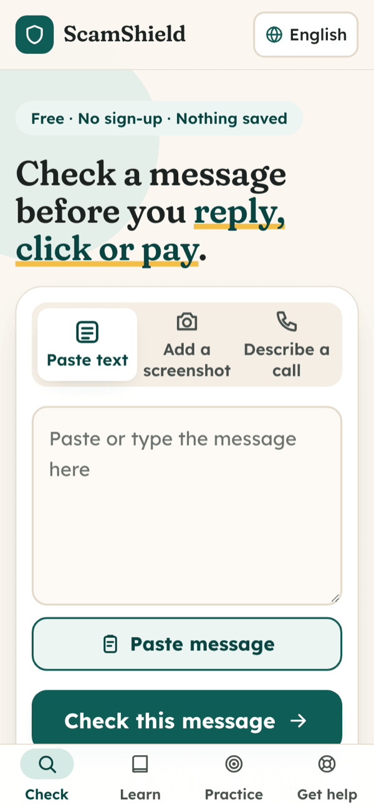
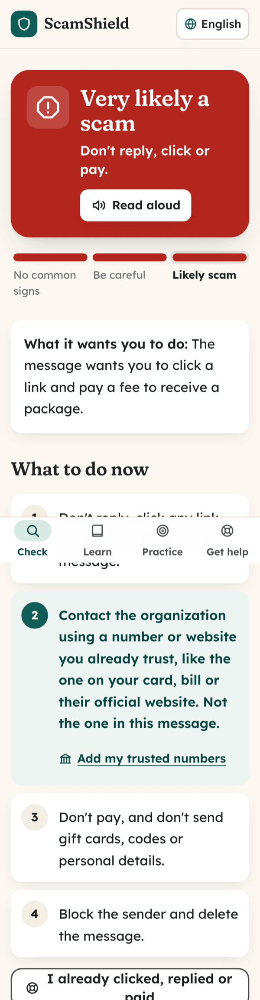
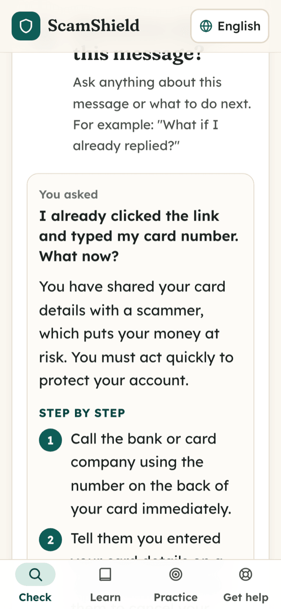
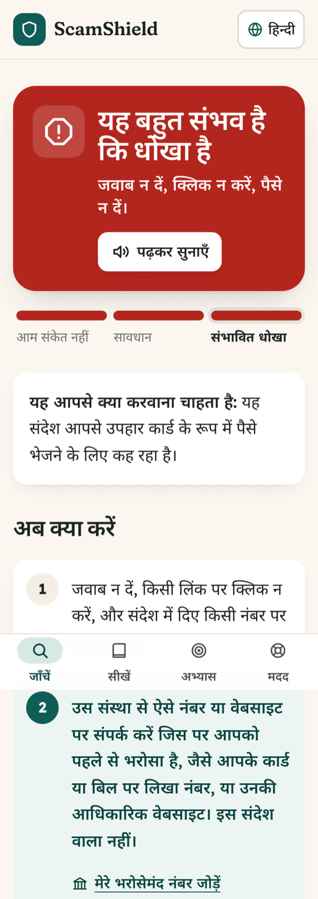
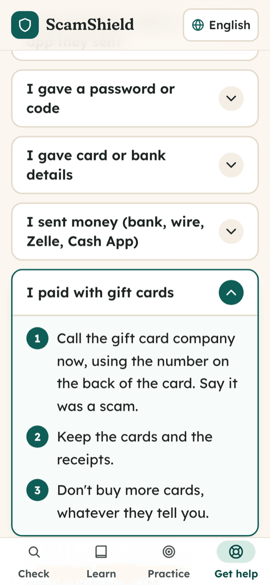
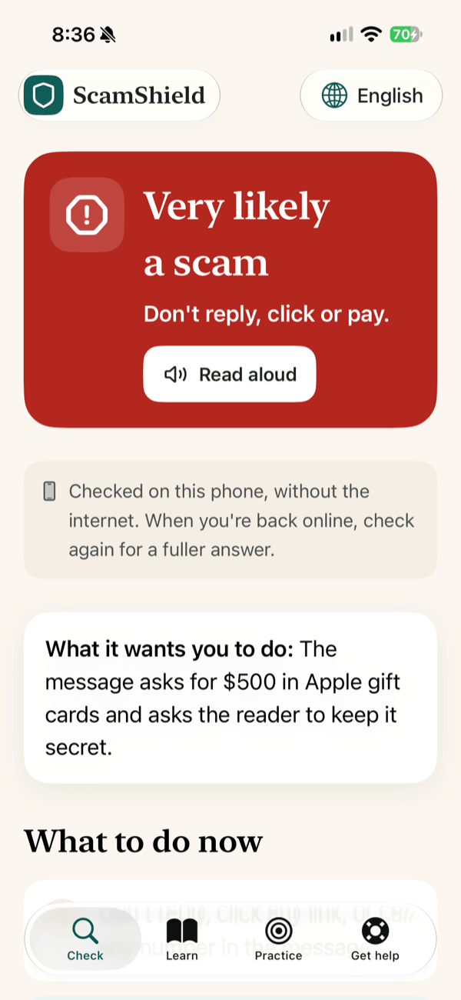
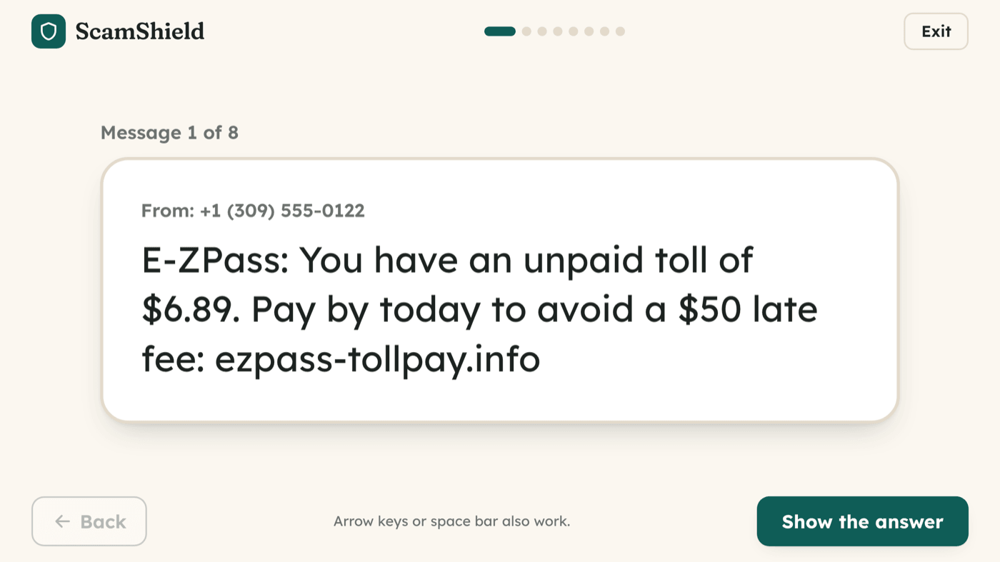
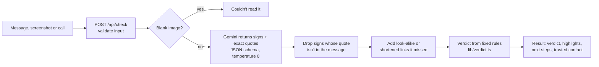

# ScamShield

Check a suspicious text, email, letter or phone call before you reply, click or pay.

**[Live app](https://checkscamshield.vercel.app)** · **[Demo video](https://drive.google.com/file/d/1jfGn6RJby9MROos2l2nZy7QVhoitxQql/view)**

ScamShield helps older adults and immigrant families spot scams in their own language. Paste a message, add a screenshot or describe a call, and get a clear verdict, the exact warning signs, and what to do next. No account, and nothing is saved.

Built for the Rotary "AI for Good: Build for Your Community" hackathon (area of focus: community economic development).

## For judges: try it in 2 minutes

No setup or account needed. Open **[checkscamshield.vercel.app](https://checkscamshield.vercel.app)** on a phone or computer, then:

1. Paste this message and tap **Check this message**:
   ```
   USPS: Your package is on hold due to an incomplete address. Pay the $1.99 redelivery fee within 24h or it will be returned: https://usps-redeliver-help.co/track
   ```
2. Read the verdict, the warning signs highlighted in the message, and the next steps.
3. Ask a follow-up, such as *"I already clicked the link, what do I do?"*
4. Try **Add a screenshot** or **Describe a call**, or switch the language (top right) to one of 7 languages.
5. Explore **Learn**, **Practice** (a spot-the-scam game), **Get help**, and the **Workshop kit** (in the footer).

To run it on your own machine, see [Getting started](#getting-started). The iPhone app is on the [`ios-app` branch](https://github.com/m4ku/ScamShield/tree/ios-app/ios).

<p align="center">
  
  
  
  
</p>
<p align="center">
  
  
  
</p>

## The problem

Scams are draining the savings of the people least able to recover from it:

- Americans 60 and older reported **$7.7 billion** in losses to the FBI in 2025, up about 59% in one year ([FBI IC3 2025 report](https://www.ic3.gov/AnnualReport/Reports/2025_IC3Report.pdf)).
- Older adults reported about **$3 billion** in fraud losses to the FTC in 2025, and the FTC estimates the true cost is many times higher because most fraud goes unreported ([FTC, Protecting Older Consumers 2025–2026](https://www.ftc.gov/reports/protecting-older-consumers-2025-2026-report-federal-trade-commission)).
- Government-impersonation and phishing scams against older adults grew fastest, and they increasingly arrive in the reader's own language.

The moment that matters is the few minutes between getting a message and acting on it. Generic advice ("be careful with links") doesn't help then, and family members aren't always there to ask. People need a quick, trustworthy second opinion in their own language, with clear steps if they've already clicked or paid.

## Who it helps, and how it reaches them

- **Older adults:** large text, read-aloud, voice input, one big button per screen, no account.
- **Immigrant families:** every screen, warning and next step in 7 languages, including help resources.
- **Rotary clubs, libraries and senior centers:** the built-in workshop kit (projector slides and a printable handout) turns ScamShield into a 20-minute community session, so it spreads person to person, not just through app stores.
- **Privacy by design:** messages are never stored or logged, so people can check a bank alert or a family text without worry.

## Features

- **Check a message** by pasting text, uploading a screenshot, or describing a call
- **Clear verdict:** *Very likely a scam*, *Be careful*, or *No common warning signs found* (it never says "safe")
- **Warning signs highlighted** in the message and explained in plain language
- **Next steps** for every result, plus follow-up questions with step-by-step answers
- **Help if you already acted:** 12 situations, from a clicked link to money sent
- **Learn and Practice:** 8 common scam types and a "spot the scam" game
- **Workshop kit:** presenter mode and a printable handout for community sessions
- **7 languages:** English, Spanish, Chinese (Simplified), Vietnamese, Tagalog, Hindi, French
- **Accessible:** large text, read-aloud, voice input, installable on a phone
- **Native iPhone app** (on the [`ios-app` branch](https://github.com/m4ku/ScamShield/tree/ios-app/ios)): the same checks, plus offline checking on the phone with Apple's on-device model (it warned on all 78 scam or suspicious test messages, in about 3 seconds each) and a "Share to ScamShield" option in the share sheet

## How it works

The AI reads the message; our code decides the verdict. The model returns the warning signs it finds as structured JSON, each with the exact words quoted from the message. The server then:

1. Drops any sign whose quote isn't actually in the message
2. Flags look-alike and shortened links the model missed
3. Computes the verdict from fixed rules ([`lib/verdict.ts`](lib/verdict.ts))



Follow-up answers are also checked in code, so they can't call a message safe or repeat a scammer's links and phone numbers. Message content is never stored or logged, and the API key stays on the server.

## Getting started

Requires Node.js 20+ and a free [Gemini API key](https://aistudio.google.com/apikey).

```bash
git clone https://github.com/m4ku/ScamShield.git
cd ScamShield
npm install
cp .env.example .env   # add your GEMINI_API_KEY
npm run dev
```

Open http://localhost:3000.

## Testing

```bash
npm test                                   # unit tests, no AI calls
npm run test:ai                            # 150 AI test cases against localhost
npm run test:ai -- --base <url> --only core   # another server, selected sections
```

[`tests/TEST-KIT.md`](tests/TEST-KIT.md) lists every case for testing by hand.

## Tech stack

Next.js 16, React 19, TypeScript, Tailwind CSS, Zod, and Google Gemini through `@google/genai`, deployed on Vercel. All model calls go through [`lib/ai/`](lib/ai/), so changing providers is a one-file change.

## Limitations

ScamShield looks for common warning signs. It can miss new tricks and can't prove a message is real, so people should always confirm with the organization directly. Help resources are US-focused.

## Team

[m4ku](https://github.com/m4ku) and [J-Tunz](https://github.com/J-Tunz)
